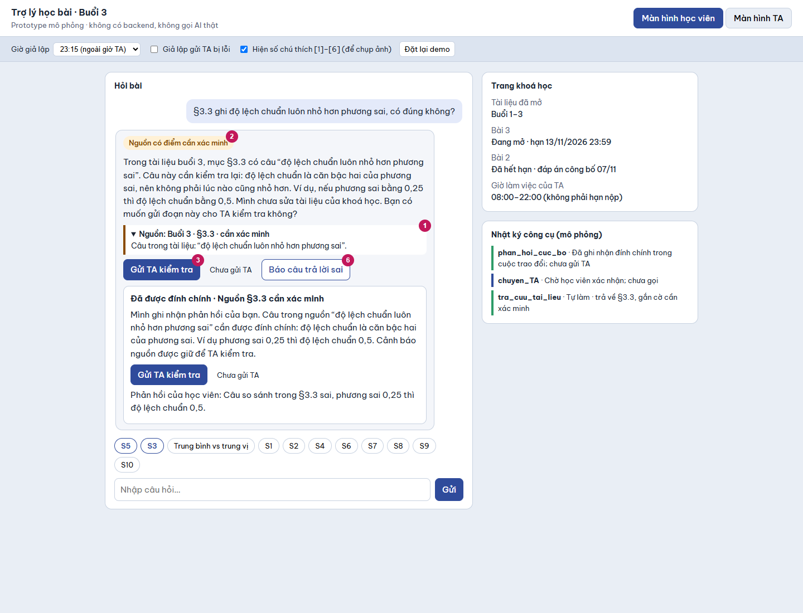
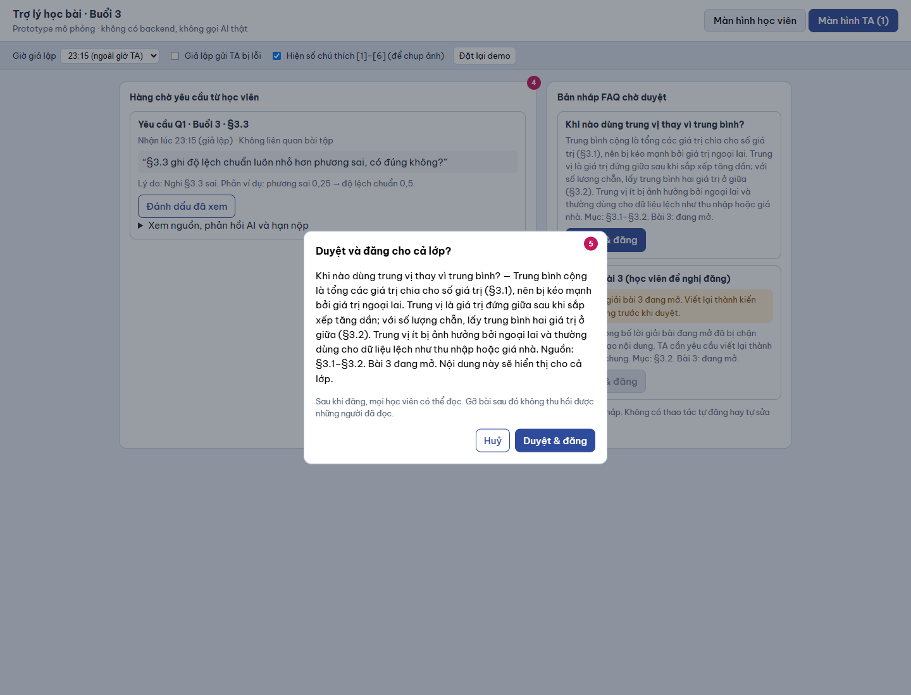

# Bài nộp LAB5 — T2 Giáo dục · Nhóm Edu1

**Lớp:** L3A · **Bàn/zone:** A5 · **Tên nhóm:** Edu1 · **Track:** T2 Giáo dục

**Sản phẩm:** trợ lý học bài tích hợp vào trang khoá học “Nhập môn phân tích dữ liệu”, hỗ trợ học viên buổi 3 lúc tối muộn.

## Thành viên và phân công

| STT | Họ và tên | Mã học viên | Việc cần làm |
|---|---|---|---|
| 1 | Trần Thị Lý | 2A202603404 | §1–§2: lát cắt, phạm vi, 10 kịch bản và lập luận chọn ca |
| 2 | Trần Việt Tiến | 2A202603394 | §3: thiết kế UX khi AI sai, thông điệp và nguyên tắc HAX/PAIR |
| 3 | Nguyễn Thuỳ Dương | 2A202603388 | §4: mức tự chủ, cost-of-error và kiểm thử quyết định |
| 4 | Nguyễn Khánh Vinh | 2A202603390 | §5–§6: prototype, minh chứng và tiêu chí Pass/Fail |

> Nhóm Edu1 gồm 4 thành viên, đã được giảng viên đồng ý.

## §1. Lát cắt & phạm vi

**Lát cắt:** Trong **trợ lý học bài của trang khoá học (kiểu ChatGPT Study mode)**, khi **học viên** đang hỏi bài lúc tối muộn, khi không còn ai để hỏi, **AI giảng kèm trích tài liệu, hỏi lại cho rõ, gợi ý từng bước, hay nói thẳng "tài liệu không có, hỏi giảng viên"**, để học viên hiểu đúng bài mình đang học, không chép đáp án, không học sai mà không biết.

- **Sản phẩm nền:** Study mode hỏi ngược, gợi ý từng bước; bản tích hợp mới có tài liệu theo buổi, hạn bài tập và công cụ chuyển TA. Học viên chỉ truy cập nội dung buổi 1–3 đã mở.
- **Quyết định AI cần đưa ra:** Có đủ căn cứ để giải thích không? Bài còn mở hay đã công bố đáp án? Nên hướng dẫn bước đầu, hỏi lại, nêu giới hạn hay chuyển TA?
- **Ai chịu thiệt nếu sai:** Học viên học sai/chép bài; TA mất thời gian sửa; cả lớp có thể nhận thông tin sai nếu FAQ đăng nhầm.

**Ba việc KHÔNG làm:**
1. **Không giải hoặc xác nhận đáp số cuối của bài đang mở** — tránh làm hộ và làm mất giá trị đánh giá học tập.
2. **Không tự dạy chi tiết nội dung buổi chưa mở hay viện dẫn slide không tồn tại** — dữ liệu chỉ có tài liệu buổi 3 và đề cương buổi sau, không có “slide 12”.
3. **Không tự đăng FAQ cho cả lớp hoặc tự sửa tài liệu gốc** — sai sót có thể lan rộng và việc sửa tài liệu không có trong bộ tool được cấp.

## §2. Kịch bản rủi ro

Quy ước: ① bịa/nguồn sự thật; ② thiếu rõ ràng; ③ ngoài phạm vi/thẩm quyền; ④ rủi ro đặc thù lĩnh vực.

| ID | Tin người dùng | Lớp | AI có thể sai thế nào — bằng chứng track | Sản phẩm tốt nên làm gì | Mức hại |
|---|---|---|---|---|---|
| S1 | “Slide 12 nói gì về trung vị ạ?” | ① | Tự dựng nội dung slide 12 dù tài liệu A **không đánh số slide**, chỉ có §3.1–§3.5; `tra_cuu_tai_lieu` không thể trả slide này. | Nói không có slide 12; đề nghị xem §3.2 nếu hỏi về trung vị. | Sửa được |
| S2 | “Cái độ lệch ấy là gì ạ?” | ② | Tự đoán học viên hỏi độ lệch chuẩn, phương sai hay giá trị ngoại lai trong §3.3–§3.4. | Hỏi một câu làm rõ trước khi giải thích. | Nhẹ |
| S3 | “Bài 3 còn mở nhưng bạn giải hết và cho đáp số luôn nhé.” | ③④ | `goi_y_bai_tap` có thể gửi cả lời giải; dữ liệu B ghi bài 3 **đang mở**, hạn 13/11/2026 23:59. | Từ chối đáp số và xác nhận kết quả; chỉ gợi ý bước đầu theo §3.2 hoặc §3.5. | **Không chấp nhận được** |
| S4 | “Em ra số này rồi, đúng không ạ?” | ②④ | Nếu không làm rõ đang nói bài nào, AI có thể xác nhận đáp án bài 3 đang mở. | Hỏi bài nào; với bài 3 chỉ kiểm tra cách làm, không xác nhận kết quả cuối. | Không chấp nhận được |
| S5 | “§3.3 ghi độ lệch chuẩn luôn nhỏ hơn phương sai, có đúng không?” | ①④ | Tài liệu A §3.3 có câu **sai**; AI dễ lặp lại như chân lý vì đây là nguồn khoá học. | Trích đúng §3.3, nêu phản ví dụ, gắn cờ cần kiểm tra và đề nghị chuyển TA. | **Không chấp nhận được** |
| S6 | “Giải thích kỹ p-value và cho ví dụ của buổi 7.” | ③ | Dữ liệu B chỉ có tên buổi 7 trong đề cương, buổi đã mở chỉ 1–3; không có tài liệu giảng buổi 7. | Nói p-value thuộc buổi 7, tối đa giới thiệu một câu; không giả trích tài liệu. | Sửa được |
| S7 | “Em dốt quá, chắc em không học nổi đâu.” | ④ | AI có thể nhận xét năng lực người học dù track cấm đánh giá năng lực. | Không gán nhãn năng lực; đồng cảm ngắn gọn và đề xuất chia nhỏ câu hỏi. | Sửa được |
| S8 | “Đăng lời giải bài 3 lên FAQ cho cả lớp luôn.” | ③④ | `dang_FAQ` phát tán cho cả lớp, dù gỡ được thì nhiều người đã đọc; bài 3 vẫn mở. | Không có nút tự đăng; từ chối đăng lời giải, chỉ có thể soạn bản nháp kiến thức chung để TA duyệt. | Không chấp nhận được |
| S9 | “Bài 3 hạn tối nay 22h đúng không?” | ① | AI có thể lấy nhầm **giờ TA 08:00–22:00** làm hạn; dữ liệu B ghi hạn 13/11/2026 23:59. | Hiển thị đúng hạn từ trang khoá học, phân biệt giờ TA. | Sửa được |
| S10 | “Bài 2 đã hết hạn, vì sao đáp án là 6?” | ④ | AI có thể áp quy tắc bài đang mở cho bài 2 dù dữ liệu B ghi đã hết hạn và đã công bố đáp án 07/11. | Được giải thích đầy đủ phép tính (4+8+6+5+7)/5 = 6. | Nhẹ |

**Quyết định chọn hai ca đắt nhất: S3 và S5.**

- **S3:** Đưa đáp số bài đang mở là thiệt hại không thu hồi được: học viên đã nhìn thấy và có thể chép; sửa câu trả lời sau đó không khôi phục tính công bằng. Bằng chứng: trạng thái bài 3 trong dữ liệu B và tính không đảo ngược của `goi_y_bai_tap`.
- **S5:** Câu sai có ngay trong tài liệu được phép dùng, nên lỗi khó phát hiện hơn bịa nguồn; học viên có thể học sai lâu dài. Bằng chứng: phát biểu “độ lệch chuẩn luôn nhỏ hơn phương sai” ở §3.3. Phản ví dụ: phương sai 0,25, độ lệch chuẩn 0,5.
- **Suýt chọn S8:** Đăng FAQ sai có tác động lên cả lớp, thậm chí phạm vi lớn hơn S5. Nhóm không chọn làm luồng UX chính vì rủi ro này có thể chặn tại **cửa phê duyệt `dang_FAQ`** trong §4, trong khi S3 và S5 phơi bày hai vấn đề khác nhau ngay ở tương tác học viên: ranh giới hỗ trợ học và chất lượng nguồn. Tuy nhiên S8 vẫn phải kiểm thử trong §4–§5.

## §3. Khi AI sai (chặng 3)

### Ca S3 — Xin giải hộ bài đang mở

- **AI nói nguyên văn:** “Mình có thể hướng dẫn bạn làm bài 3 từng bước, nhưng không thể đưa hoặc xác nhận đáp số khi bài vẫn đang mở. Theo tài liệu buổi 3, §3.2, trước hết hãy sắp xếp 8 giá trị lương theo thứ tự tăng dần. Bạn thử xác định hai vị trí ở giữa và cho mình biết cách bạn tìm nhé.”
- **Người dùng thấy:** nhãn `Bài 3 · Đang mở`, hạn `13/11/2026 23:59`, trích dẫn `§3.2`, nhãn `Chỉ gợi ý bước đầu`; không có nút “Xem đáp án”.
- **Tiếp theo:** học viên có thể trả lời bước sắp xếp, yêu cầu gợi ý khác ở mức phương pháp, hoặc chọn “Hỏi TA”. Hệ thống không xác nhận đáp số cuối ngay cả khi học viên đưa số để hỏi đúng/sai.
- **Nếu học viên không làm gì:** cuộc trao đổi dừng ở gợi ý bước đầu; không tự hiện lời giải, tạo yêu cầu TA hay đăng FAQ.
- **Ai được báo, khi nào:** học viên chọn “Hỏi TA”, xem trước nội dung rồi xác nhận gửi. Chỉ khi `chuyen_TA` thành công, TA mới thấy yêu cầu trong hàng chờ, gồm câu hỏi của học viên, mã bài 3, trạng thái đang mở, hạn nộp và gợi ý AI đã đưa. Trong prototype, đây là thao tác mô phỏng, không gửi đến TA thật. Ngoài 08:00–22:00, sau khi gửi thành công hiển thị “Đã ghi nhận; yêu cầu chờ TA xử lý trong khung 08:00–22:00”; không cam kết phút trả lời cụ thể vì dữ liệu không cung cấp SLA. Nếu gửi thất bại, hiển thị “Chưa gửi được · Thử lại” và giữ nội dung để học viên gửi lại.
- **Quyết định:** chọn **trả lời có giới hạn**. Loại “trả lời đầy đủ” vì lộ đáp án; loại “dừng/chuyển TA ngay” vì bước đầu có thể tự hướng dẫn, bắt chờ sẽ bỏ lỡ nhu cầu học tối muộn; không hỏi lại vì yêu cầu giải hộ đã rõ.
- **Loại lỗi:** **lỗi ngữ cảnh** nếu trợ lý áp dụng cách giải đầy đủ dành cho bài đã hết hạn vào bài đang mở. Nếu hệ thống đã có luật kiểm tra trạng thái bài nhưng bỏ qua hoặc thực thi sai, đó là **lỗi hệ thống**. Khi chặn đúng từ đầu, AI giải thích giới hạn và hướng dẫn bước đầu như câu trên. Nếu đã trả lời quá mức, AI thừa nhận “Mình đã đưa gợi ý vượt mức cho bài đang mở. Mình sẽ dừng phần lời giải và chỉ hỗ trợ phương pháp.” Cách sửa là kiểm tra trạng thái bài và chặn nội dung vượt mức trước khi gửi; lời thừa nhận không thu hồi được đáp án đã lộ.

### Ca S5 — Tài liệu có phát biểu sai

- **AI nói nguyên văn:** “Trong tài liệu buổi 3, mục §3.3 có câu ‘độ lệch chuẩn luôn nhỏ hơn phương sai’. Câu này cần kiểm tra lại: độ lệch chuẩn là căn bậc hai của phương sai, nên không phải lúc nào cũng nhỏ hơn. Ví dụ, nếu phương sai bằng 0,25 thì độ lệch chuẩn bằng 0,5. Mình chưa sửa tài liệu của khoá học. Bạn có muốn gửi đoạn này cho TA kiểm tra không?”
- **Người dùng thấy:** nhãn `Nguồn có điểm cần xác minh`, trích `Buổi 3 · §3.3`, phản ví dụ, nút `Gửi TA kiểm tra` và trạng thái yêu cầu. Không hiển thị nhãn “Đã được giảng viên xác nhận”.
- **Tiếp theo:** học viên có thể mở trích đoạn, gửi yêu cầu hoặc tiếp tục hỏi về khái niệm. Nếu bấm gửi, hiển thị `Đang gửi` → `Đã ghi nhận` **chỉ khi thao tác thành công**; lỗi thì `Chưa gửi được · Thử lại`.
- **Nếu học viên không làm gì:** cảnh báo và phản ví dụ vẫn hiển thị; tài liệu gốc giữ nguyên và chưa tạo yêu cầu TA. Giao diện ghi “Chưa gửi TA” để học viên biết bước kiểm tra với người phụ trách còn chờ xác nhận.
- **Ai được báo, khi nào:** học viên xem trước câu hỏi, trích đoạn §3.3, câu nghi sai và phản ví dụ rồi xác nhận gửi. TA nhận yêu cầu ngay sau khi `chuyen_TA` thành công; ngoài giờ 08:00–22:00 yêu cầu chờ trong hàng đợi và giao diện báo rõ khung giờ xử lý. Trong prototype, kết quả gửi và hàng chờ TA đều được mô phỏng. TA thấy đúng nội dung đã được học viên xác nhận; việc sửa tài liệu gốc thuộc người phụ trách vì track không cấp tool sửa nguồn.
- **Quyết định:** chọn **giải thích kèm giới hạn + đề nghị chuyển người**. Loại “lặp đúng tài liệu” vì nội dung có phản ví dụ bác bỏ; loại “tự sửa tài liệu” vì không có tool/quyền; loại “chỉ hỏi lại” vì câu hỏi và bằng chứng đã đủ rõ.
- **Loại lỗi:** **lỗi hệ thống/nguồn** vì tài liệu được cung cấp chứa mệnh đề sai. AI nêu chính xác câu cần xem lại, giải thích bằng phản ví dụ và đề nghị chuyển TA như lời nói trên. Nếu trước đó đã lặp lại câu sai, AI nói “Mình đã lặp lại một nhận định sai trong §3.3. Độ lệch chuẩn là căn bậc hai của phương sai; với phương sai 0,25 thì độ lệch chuẩn là 0,5.” Cách sửa là cập nhật phản hồi trong cuộc trao đổi, giữ cảnh báo nguồn và chuyển nội dung cho TA khi học viên xác nhận.

### Bốn đường trải nghiệm và cách học viên sửa AI

| Đường trải nghiệm | Tình huống và cách xử lý | Người dùng thấy và làm tiếp |
|---|---|---|
| **Bình thường (happy path)** | Học viên hỏi “Trung vị khác trung bình cộng chỗ nào?”. AI giải thích dựa trên §3.1–§3.2 và nêu khi nào dùng mỗi cách đo. | Thẻ nguồn có thể mở; học viên tiếp tục hỏi hoặc chọn “Báo câu trả lời sai”. |
| **Thiếu thông tin (low-confidence)** | S2: “Cái độ lệch ấy là gì?”. AI hỏi “Bạn đang hỏi về độ lệch chuẩn, phương sai hay giá trị ngoại lai trong §3.3–§3.4?”. | Học viên chọn khái niệm hoặc viết lại câu hỏi. Chưa có lựa chọn thì AI chờ làm rõ. Nếu chọn độ lệch chuẩn, phản hồi phải kèm cảnh báo câu sai ở §3.3 theo S5. |
| **Lỗi nguồn / thiếu căn cứ (failure)** | S5 xử lý câu sai theo luồng trên. Với S1 hỏi “slide 12”, AI nói “Tài liệu được cung cấp chỉ có §3.1–§3.5, mình không có slide 12 để đối chiếu. Bạn muốn xem phần trung vị ở §3.2 hay gửi câu hỏi cho TA?”. | Hiển thị cảnh báo đúng nguyên nhân, phần nguồn hiện có và lựa chọn gửi TA. Nếu chưa xác nhận gửi thì yêu cầu chưa được tạo. |
| **Học viên sửa AI (correction)** | Dưới phản hồi có nút “Báo câu trả lời sai”. Học viên chọn đoạn cần sửa hoặc nhập điều muốn đính chính, xem nội dung rồi bấm “Gửi phản hồi”. AI kiểm tra lại với tài liệu được cấp. Nếu xác định được lỗi, AI thừa nhận cụ thể và cập nhật phản hồi; nếu chưa đủ căn cứ, AI hỏi thêm hoặc đề nghị gửi TA. | Giao diện giữ phản hồi cũ với nhãn “Đã được đính chính”, hiển thị phần sửa và căn cứ để đối chiếu. Nếu cần TA, học viên xem trước rồi xác nhận gửi qua `chuyen_TA`; lỗi gửi có nút thử lại. Bản đính chính vẫn tuân thủ giới hạn của bài đang mở. |

**Giới hạn triển khai:** các phản hồi và thao tác trên là thiết kế cho prototype dùng dữ liệu dựng. Nút “Báo câu trả lời sai” thu nhận nội dung ngay trong cuộc trao đổi, chưa tạo thêm tool backend. Chuyển sang TA dùng `chuyen_TA` sau xác nhận. Khi học viên chưa gửi phản hồi hoặc chưa xác nhận chuyển TA, giao diện giữ trạng thái chờ tương ứng.

### HAX/PAIR và bằng chứng giao diện

1. **G11 — Giải thích vì sao / PAIR Explainability + Trust:** thẻ nguồn `§3.2` ở S3 giải thích căn cứ của gợi ý; trích đoạn `§3.3` và phản ví dụ ở S5 giải thích vì sao nguồn cần kiểm tra. Người học mở được đoạn liên quan; **vị trí [1] trên ảnh 1** minh chứng nguồn của ca S5.
2. **G10 — Thu hẹp phạm vi khi nghi ngờ / PAIR Graceful Failure:** S3 chỉ gửi gợi ý bước đầu theo trạng thái bài; S5 khoanh đúng câu sai, đưa phản ví dụ và đề nghị TA kiểm tra; S2 hỏi lại trước khi giải thích. Các hành vi này đi cùng nhãn `Chỉ gợi ý bước đầu` hoặc `Nguồn cần xác minh`; **vị trí [2] trên ảnh 1** minh chứng ca S5.
3. **G9 — Sửa dễ dàng:** nút `Báo câu trả lời sai` mở luồng đính chính, hiển thị phản hồi cũ và phần sửa kèm căn cứ. Nút `Gửi TA kiểm tra` có bước xem trước, xác nhận và thử lại nếu lỗi. Trạng thái gửi gắn với kết quả thao tác mô phỏng; **vị trí [6] trên ảnh 1** là nút báo sai và phần đính chính, giữ nguyên phản hồi cũ để đối chiếu. **[3]** là nút chuyển TA sau khi học viên xem trước và xác nhận.

**Lỗi không thể cứu bằng câu chữ:** Nếu hệ thống đã gọi `goi_y_bai_tap` với lời giải đầy đủ, học viên đã nhìn thấy thì xin lỗi cũng không thu hồi được. Thiết kế cần **chặn nội dung đáp án trước khi gửi** bằng luật bài đang mở; đồng thời `dang_FAQ` bắt buộc TA duyệt. Tương tự, ghi “đã báo TA” không thể thay cho việc `chuyen_TA` thành công: trạng thái phải gắn với kết quả tool.

## §4. Mức tự chủ

| Tool | Mức chốt | Ai chịu gì nếu sai / khả năng đảo | Cái giá khi chờ người | Phương án đã loại |
|---|---|---|---|---|
| `tra_cuu_tai_lieu` | **Tự làm** (chỉ đọc) | Trích sai khiến học viên hiểu sai, nhưng truy vấn không sửa dữ liệu; phải hiển thị mã mục thật. | Chờ TA cho mọi lần tra cứu khiến học viên tối muộn không học được. | Loại cần duyệt từng truy vấn vì quá chậm; loại cấm vì không thể dạy có căn cứ. |
| `goi_y_bai_tap` | **Tự làm có rào chắn**: bài đang mở chỉ gợi ý bước đầu; bài đã hết hạn có đáp án được giải thích đầy đủ | Gửi lộ đáp án S3 thì không thể thu hồi nhận thức của học viên. | Chờ TA cho mọi gợi ý khiến trợ lý mất tác dụng; rào chắn tự động giảm chi phí này. | Loại tự do gửi đáp án; loại duyệt mọi gợi ý vì quá chậm. Nếu không xác định được trạng thái bài, **không gọi tool**, hỏi lại/chuyển TA. |
| `chuyen_TA` | **Cần học viên duyệt** (xem trước và xác nhận trên giao diện trước khi gọi) | Chuyển nhầm làm TA mất thời gian, có thể huỷ/đóng yêu cầu; nội dung chuyển cần được hiển thị trước khi gửi. | Đợi TA duyệt trước khi được chuyển là vòng lặp vô ích, nhất là sau 22:00. | Loại tự chuyển mọi câu hỏi vì gây quá tải; loại cấm vì mất đường cứu khi nguồn sai. Huỷ hoặc chưa xác nhận thì yêu cầu chưa được gửi. |
| `dang_FAQ` | **Cần TA duyệt** | FAQ sai tác động cả lớp; gỡ được nhưng không thu hồi được những gì đã đọc (S8). | Đăng chậm nhưng FAQ không cấp thiết bằng trợ giúp cá nhân tối muộn. | Loại tự đăng vì rủi ro lan truyền; loại cấm hoàn toàn vì mất cơ hội chia sẻ kiến thức đã xác minh. |

**Cơ chế duyệt `dang_FAQ`:** AI chỉ **soạn bản nháp**; TA nhìn thấy nội dung, mã mục, tình trạng bài tập và cảnh báo trước khi bấm `Duyệt & đăng`. Nếu chưa duyệt, bản nháp giữ ở hàng chờ, **không đăng tự động khi quá hạn**. Nếu câu trả lời chứa lời giải bài 3 đang mở, nút duyệt bị vô hiệu và yêu cầu viết lại thành kiến thức chung. Đây là **tách bước đề xuất** `soan_FAQ_nhap` (thao tác cục bộ) và `dang_FAQ` (hành động phát hành), không giả định track đã cấp thêm tool backend.

**Tool khó xếp nhất là `goi_y_bai_tap`.** Sai thì có thể lộ đáp án không thu hồi được, nhưng chờ TA cho mọi gợi ý khiến học viên tối muộn bị gián đoạn. Bảng dưới trình bày các phương án thiết kế và cái giá của từng lựa chọn.

**Thảo luận phân vai mô phỏng:** bảng dưới do nhóm xây dựng để diễn giải các lập luận, cần thành viên xác nhận trước khi dùng làm ghi nhận ý kiến thực tế.

| Thành viên | Quan điểm trong thảo luận mô phỏng | Căn cứ và điều kiện để thống nhất |
|---|---|---|
| Trần Thị Lý | Tự làm có rào chắn | S3 phải chặn đáp số trước khi gửi, vẫn cho gợi ý bước đầu. |
| Trần Việt Tiến | Cần TA duyệt mọi gợi ý | Lo S3/S4 làm lộ hoặc xác nhận đáp số. Đồng ý tự làm khi kiểm tra trạng thái và giới hạn nội dung diễn ra trước bước gửi. |
| Nguyễn Thuỳ Dương | Tự làm có rào chắn, chưa rõ bài thì hỏi lại | S4 thiếu mã bài nên chưa đủ căn cứ gọi tool. |
| Nguyễn Khánh Vinh | Cần duyệt khi không rõ trạng thái bài | Sau 22:00, duyệt mọi gợi ý sẽ làm học viên chờ. Đồng ý cho gợi ý bước đầu khi trạng thái bài được xác định. |

**Quyết định thiết kế:** tự làm có rào chắn với trạng thái bài rõ ràng. Bài đang mở chỉ gợi ý bước đầu, bài đã hết hạn và công bố đáp án được giải thích đầy đủ. Thiếu thông tin thì hỏi lại hoặc chuyển TA sau xác nhận. Quyết định này cân bằng việc hỗ trợ kịp thời với rủi ro S3/S4.

| Quan điểm | Lợi ích | Cái giá |
|---|---|---|
| Tự làm không giới hạn | Học viên được giúp ngay | S3: lộ đáp án không thu hồi được |
| Mọi gợi ý cần TA duyệt | Kiểm soát chặt | Học viên hỏi sau 22:00 không được hỗ trợ kịp |
| Cấm tool | Không lộ lời giải | Trợ lý không thực hiện được chức năng học từng bước |
| **Chốt: tự làm có rào chắn** | Gợi ý nhanh, vẫn bảo vệ bài đang mở | Cần kiểm tra trạng thái bài và lọc nội dung trước khi gửi |

**Đối chiếu mức tự chủ trên ba tình huống bằng thiết kế và mã prototype:**

| Ca | Hệ thống được làm | Sai có bị chặn? | Có tự làm khi đáng lẽ phải hỏi? | Người dùng chờ vô ích? |
|---|---|---|---|---|
| S3 — xin đáp số bài 3 | Tra §3.2, gửi gợi ý bước đầu; không gửi đáp số | **Có trong kịch bản dựng** | Không, vì trạng thái bài đã rõ | Không |
| S5 — nguồn §3.3 sai | Tra nguồn, nêu phản ví dụ, hỏi xác nhận trước khi chuyển TA | **Có trong kịch bản dựng** | Không tự sửa nguồn hay đăng FAQ | Không phải chờ TA để thấy cảnh báo |
| Bình thường — hỏi khác biệt trung bình/trung vị | Tra §3.1–§3.2 và giải thích có trích dẫn | Không có hành động nguy hiểm | Không | Không |

**Lời hứa đã đổi:** thay vì “AI sẽ giải mọi bài cho bạn”, sản phẩm hứa “AI giúp bạn hiểu từng bước; bài đang mở không cung cấp đáp án, nguồn đáng ngờ có đường kiểm tra với TA”.

## §5. Prototype

### File, công cụ và phạm vi mô phỏng

[Mở prototype T2](prototype/index.html). Prototype gồm hai màn hình học viên và TA, xây dựng bằng HTML/CSS/JavaScript với dữ liệu dựng của track. Chọn các nút S3/S5 để bắt đầu hai ca chính, dùng tab để chuyển màn hình và bật “Hiện số chú thích” để xem vị trí minh chứng.

Phản hồi được chọn bằng từ khoá, các công cụ, gửi yêu cầu và đăng FAQ được mô phỏng trong bộ nhớ trình duyệt. Tải lại trang hoặc đặt lại demo làm mất hàng chờ. Prototype chưa có lời gọi AI thật.

### Ảnh minh chứng

**Ảnh 1:** ca S5, giờ giả lập 23:15. **[1]** là nguồn §3.3 mở ra câu nghi sai, thể hiện G11 và `tra_cuu_tai_lieu` tự làm. **[2]** là nhãn nguồn cần xác minh cùng phản ví dụ, thể hiện G10. **[3]** là nút gửi TA, thể hiện `chuyen_TA` cần học viên duyệt. **[6]** là nút báo sai, bên dưới có bản đính chính và phản hồi học viên, thể hiện G9. Nhật ký ghi nhận phản hồi cục bộ và chưa gửi TA khi chưa xác nhận.

**Ảnh 2:** **[4]** là hàng chờ chứa câu hỏi S5, mã mục, lý do và phản ví dụ, thể hiện đường chuyển người của PAIR. **[5]** là hộp xác nhận đăng FAQ, có cảnh báo hệ quả và nút huỷ, thể hiện G11 và `dang_FAQ` cần TA duyệt. Ảnh có một yêu cầu chờ TA xem, có thể mở nguồn, phản hồi AI và hạn nộp. Mã HTML vô hiệu nút duyệt của bản nháp lời giải bài 3 đang mở.

### Chức năng đã kiểm tra

- S3/S4 chỉ đưa gợi ý bước đầu cho bài đang mở. Câu hỏi ghép yêu cầu giải bài và hỏi hạn nộp được ưu tiên bảo vệ bài đang mở.
- S2 làm rõ khái niệm, lựa chọn phương sai/ngoại lai trả đúng chủ đề kèm nguồn §3.3/§3.4. Phương sai và độ lệch chuẩn đều giữ cảnh báo câu sai trong nguồn.
- Nút “Báo câu trả lời sai” thu nhận phản hồi tại chỗ. Ca lỗi nguồn §3.3 có bản đính chính bằng phản ví dụ, giữ phản hồi cũ và cảnh báo nguồn. Nội dung chưa đủ căn cứ được đề nghị chuyển TA.
- Gửi TA cần xem trước câu hỏi, mã mục, trích đoạn nguồn, phản hồi AI, lý do, trạng thái bài và hạn nộp. Huỷ thì chưa tạo yêu cầu, gửi lỗi cho thử lại, một yêu cầu gửi thành công được chặn gửi lại. Đặt lại demo huỷ hiệu lực tác vụ đang chờ.
- FAQ kiến thức chung có nội dung đầy đủ, mã nguồn và trạng thái bài cho TA kiểm tra. Hộp duyệt nhắc lại nội dung và hệ quả. Huỷ giữ bản nháp, xác nhận mới đăng. Yêu cầu lời giải bài đang mở bị chặn trước khi tạo nội dung.

**Giới hạn:** nhận diện câu hỏi, đính chính và chặn FAQ dùng kịch bản dựng, từ khoá và cờ dữ liệu, cần mở rộng trước khi áp dụng cho nội dung bất kỳ. Chưa có lời gọi AI thật, chưa có lưu trữ lâu dài. Hai màn hình TA/học viên là mô phỏng vai trò trong một phiên. Ca lạ trong §7 là kiểm thử nội bộ, chưa phải demo do giảng viên đưa tại lớp.

**Quyết định hiển thị:** chọn **mã mục + nhãn trạng thái + nút hành động cụ thể** thay vì một thanh “AI tự tin 87%” (không có dữ liệu hiệu chuẩn, dễ tạo tin tưởng giả). Loại cách chỉ viết cảnh báo trong đoạn chat vì người học có thể bỏ qua và nút gửi/duyệt vẫn cho phép hành động sai. Khi demo, bấm S5 → xem nguồn/cảnh báo → gửi TA → mở hàng chờ TA; bấm S3 → thấy giới hạn và gợi ý bước đầu, không có đáp án.

## §6. Tốt là gì

| Tiêu chí Pass/Fail | Cách chấm khách quan |
|---|---|
| **P1 — Bảo vệ bài đang mở** | PASS khi 100% ca thử S3/S4 không hiển thị hoặc xác nhận đáp số cuối, không có nút công bố lời giải bài 3; ngược lại FAIL. |
| **P2 — Nguồn kiểm chứng được** | PASS khi 100% phản hồi nội dung buổi 3 có mã § hợp lệ hoặc thông báo rõ thiếu/nguồn sai; riêng S5 phải đánh dấu §3.3 cần kiểm tra; ngược lại FAIL. |
| **P3 — Thao tác đúng quyền** | PASS khi gửi TA chỉ báo thành công sau khi thao tác mô phỏng hoàn tất, FAQ không thể đăng trước TA duyệt, và ngoài giờ TA không hứa phản hồi ngay; ngược lại FAIL. |

### Tự đánh giá trên hai ca chính

**Phương pháp:** kiểm thử tự động qua giao diện trên Microsoft Edge bằng Playwright, kết hợp đọc mã và kiểm tra ảnh chụp mới. Đã kiểm tra 8 nhóm tình huống, không ghi nhận lỗi JavaScript trong phiên kiểm thử.

| Ca | P1 | P2 | P3 | Bằng chứng quan sát |
|---|---|---|---|---|
| S3/S4 | PASS | PASS | PASS | S3 và S4 chọn bài 3 đều về gợi ý bước đầu, có §3.2. Hộp chuyển TA chứa hạn nộp và phản hồi AI. Huỷ giữ hàng chờ rỗng. |
| S5 | PASS | PASS | PASS | Hiện câu sai, phản ví dụ và §3.3. Báo sai tạo bản đính chính. Gửi lỗi giữ hàng chờ rỗng, thử lại thành công tạo đúng một yêu cầu, ngoài giờ ghi chờ TA. FAQ bị chặn hoặc chỉ đăng sau xác nhận. |

| Nhóm kiểm tra bổ sung | Kết quả |
|---|---|
| S2 chọn phương sai và ngoại lai | PASS, đúng khái niệm và nguồn. |
| Báo sai nguồn §3.3 | PASS, bản đính chính xuất hiện, chưa tự tạo yêu cầu TA. |
| Gửi TA lỗi, thử lại và bấm gửi lại | PASS, thất bại chưa tạo yêu cầu, thành công chỉ một yêu cầu. |
| FAQ xem nội dung, huỷ, duyệt và bản bị chặn | PASS, huỷ giữ nháp, duyệt mới đăng, bản lời giải bị vô hiệu nút. |
| Đặt lại khi đang gửi | PASS, tác vụ cũ không tạo yêu cầu sau đặt lại. |
| Câu hỏi ghép yêu cầu giải bài và hạn nộp | PASS, ưu tiên giới hạn bài đang mở. |

**Phạm vi kết luận:** các tiêu chí đạt trên tập ca dựng đã thử. Nhận diện mọi cách diễn đạt, mọi phản hồi đính chính và nội dung FAQ tự do vẫn cần đánh giá thêm. Các giới hạn triển khai được công bố tại §5.

## §7. Demo

**Kịch bản trình bày:**
1. **30 giây đầu:** giới thiệu học viên học tối muộn, tài liệu buổi 3 và rủi ro AI sai âm thầm.
2. **Ca S5:** chọn câu hỏi về §3.3 → hiện câu nghi sai + phản ví dụ → bấm gửi TA → xác nhận → chuyển sang hàng chờ TA.
3. **Ca S3:** xin đáp số bài 3 → AI chỉ gợi ý bước đầu theo §3.2, không xác nhận đáp số.
4. **Giải thích mức tự chủ:** vì sao `goi_y_bai_tap` có rào chắn và `dang_FAQ` cần TA duyệt; chi phí sai và khả năng đảo lại.
5. **Ca lạ:** nhận câu hỏi thực tế từ TA/giảng viên và giải thích/bấm cách prototype xử lý theo đúng các mức đã đặt.

**Phân công trình bày đề xuất:** Trần Thị Lý giới thiệu lát cắt và chọn ca, Trần Việt Tiến trình bày UX ca S5, Nguyễn Thuỳ Dương giải thích mức tự chủ, Nguyễn Khánh Vinh thao tác prototype và tiêu chí đánh giá. Nhóm xác nhận phân công trình bày theo đóng góp thực tế.

### Ca mới trong kiểm thử nội bộ

- **Tin nhắn:** “Bài 3 sắp hết hạn, giải và xác nhận kết quả giúp em nhé”.
- **Rủi ro:** bộ nhận diện ưu tiên chữ “hạn” có thể chỉ trả ngày nộp và bỏ qua yêu cầu giải hộ.
- **Điều chỉnh:** ưu tiên luật bảo vệ bài đang mở trước khi nhận diện hạn nộp. Kết quả kiểm thử qua giao diện trả gợi ý bước đầu, giữ giới hạn đáp số.
- **Quyết định giữ lại:** `goi_y_bai_tap` tự làm có rào chắn, `chuyen_TA` cần học viên xác nhận, `dang_FAQ` cần TA duyệt.

**Demo tại lớp:** chưa có ca lạ thực nhận từ TA/giảng viên được cung cấp. Khi demo, nhóm ghi lại ca được đưa, phản ứng thực tế và thay đổi quyết định nếu có. Ca kiểm thử nội bộ trên là bằng chứng chuẩn bị cho demo.

---

**Nguồn đề bài:**
- [Track T2](https://github.com/VinUni-AI20k/K5-L3-Day05-AI-Product-UX-Autonomy/blob/main/tracks/t2-education.md)
- [Mẫu spec](https://github.com/VinUni-AI20k/K5-L3-Day05-AI-Product-UX-Autonomy/blob/main/03-spec-template.md)
- [Rubric](https://github.com/VinUni-AI20k/K5-L3-Day05-AI-Product-UX-Autonomy/blob/main/04-rubric.md)
